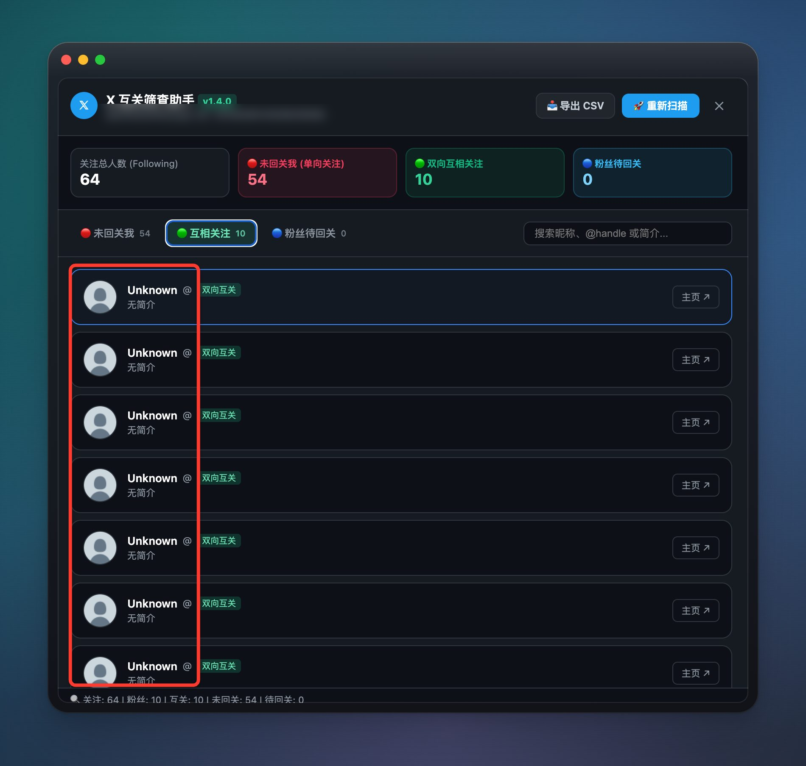

<div align="center">

# 𝕏 Mutual Follow Checker

**X（原 Twitter）互关筛查助手**

在浏览器本地识别「我关注但对方没有回关」的账号，支持查看双向互关、粉丝待回关、搜索和 CSV 导出。

[](LICENSE)
[]()
[]()

</div>

## 项目用途

这个项目用于整理 X 账号的关注关系，帮助你快速查看：

- 🔴 **未回关我**：我关注了对方，但对方没有关注我；
- 🟢 **双向互关**：双方互相关注；
- 🔵 **粉丝待回关**：对方关注了我，但我还没有关注对方。

项目直接在 X 网页端运行，不提供远程后端。扫描结果和账号数据默认只在当前浏览器中处理。

## 效果预览



截图展示了扫描统计、三类关系列表、搜索和 CSV 导出入口。截图中的账号标识已做脱敏处理。

## 推荐用法：Tampermonkey 油猴脚本

### 1. 安装 Tampermonkey

在 Chrome 或 Edge 中安装 [Tampermonkey](https://www.tampermonkey.net/)。

### 2. 安装脚本

打开项目中的 [`x-mutual-checker.user.js`](./x-mutual-checker.user.js)，复制全部内容到 Tampermonkey 的新脚本中并保存。

脚本当前版本：**1.4.1**。

### 3. 开始扫描

1. 登录 [x.com](https://x.com)；
2. 刷新页面；
3. 点击右下角的「互关筛查」悬浮按钮；
4. 点击「开始扫描」；
5. 等待 Following 和 Followers 数据加载完成。

扫描完成后，可以切换三类关系标签，使用搜索框筛选用户，或导出当前分类的 CSV 文件。

## Chrome / Edge 扩展

1. 打开扩展管理页面：

   ```text
   chrome://extensions/
   ```

   Edge 用户打开：

   ```text
   edge://extensions/
   ```

2. 开启「开发者模式」；
3. 点击「加载已解压的扩展程序」；
4. 选择本项目的 [`extension`](./extension) 文件夹；
5. 打开或刷新 [x.com](https://x.com)。

更新代码后，需要在扩展管理页面点击扩展的刷新按钮，再刷新 X 页面。

## Python CLI（备用）

CLI 版本仅使用 Python 标准库，不需要安装第三方依赖：

```bash
python3 x_checker.py
```

CLI 会要求输入当前浏览器登录状态中的 `auth_token` 和 `ct0`，并将未回关名单导出为 CSV。

**注意：Cookie 属于账号登录凭证，不要提交到 GitHub、发送给他人或写入日志。普通用户优先使用油猴脚本或浏览器扩展。**

## 工作原理

工具从 X 网页端读取当前账号的 Following 和 Followers 列表，在本地进行集合运算：

```text
双向互关       = Following ∩ Followers
未回关我       = Following - Followers
粉丝待回关     = Followers - Following
```

扫描过程中会分页获取数据，并在遇到 X 限频时等待后重试。

## 隐私与安全

- 项目没有自建后端，不上传账号数据；
- 油猴脚本和浏览器扩展不要求用户手动输入 Cookie；
- 扫描结果默认只保存在当前页面内存中；
- 导出的 CSV 可能包含昵称、主页链接、粉丝数和简介，请妥善保存；
- 取关属于真实账号操作，使用前请确认目标账号；
- X 的网页接口和返回结构可能变化，接口变化时工具可能需要更新。

## 常见问题

### 看不到“互关筛查”按钮

确认脚本或扩展已启用，当前页面是 `https://x.com`，并且已经登录。安装或更新后刷新 X 页面。

### 列表显示 `Unknown` 或空简介

请确认运行的是 **1.4.1** 版本。旧版本对 X 当前 GraphQL 用户资料结构兼容性不足。

### 扫描很慢

Followers 详情需要分页加载。粉丝数量较多时扫描时间会增加，遇到 429 限频时会自动等待。

## 开发检查

```bash
node --check x-mutual-checker.user.js
node --check extension/content.js
node --check extension/popup.js
python3 -m unittest -v
```

## License

[MIT License](LICENSE)

Copyright © 2026 mrfan
